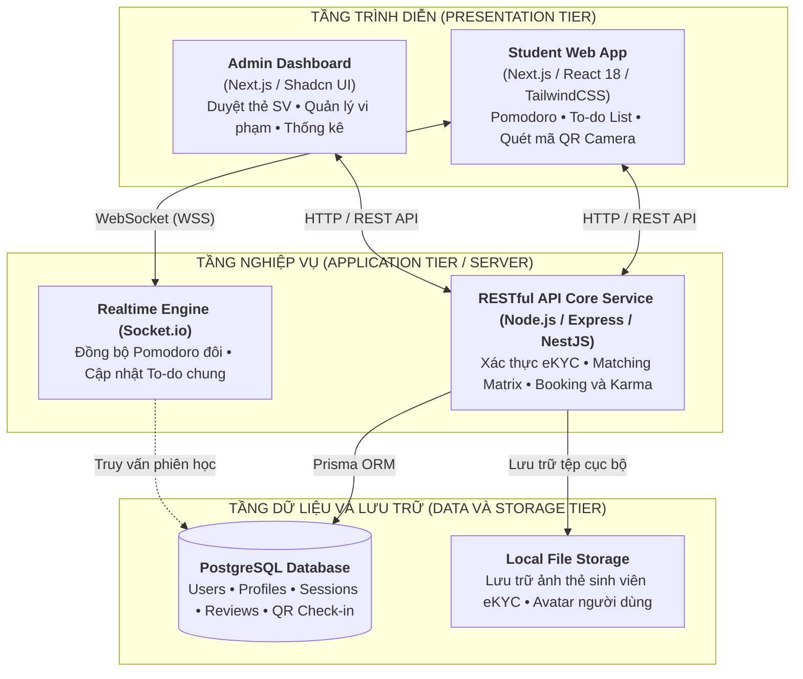
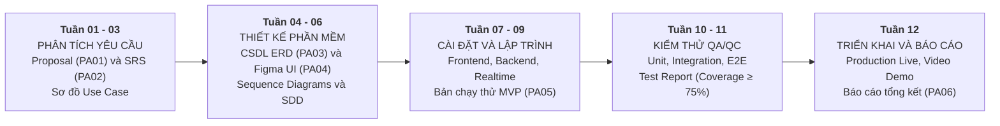
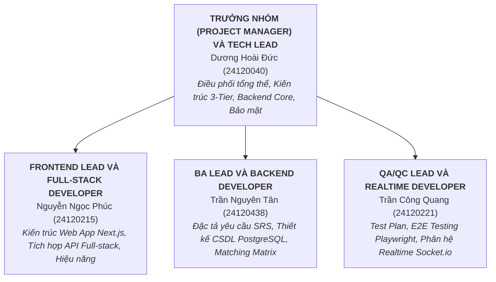

# TRƯỜNG ĐẠI HỌC KHOA HỌC TỰ NHIÊN, ĐHQG-HCM
## KHOA CÔNG NGHỆ THÔNG TIN – BỘ MÔN CÔNG NGHỆ PHẦN MỀM
***

# TÀI LIỆU ĐỀ XUẤT ĐỒ ÁN (PROJECT PROPOSAL)
### MÔN HỌC: NHẬP MÔN CÔNG NGHỆ PHẦN MỀM (CSC13002)

**ĐỀ TÀI:**  
## **StudyMate – Nền tảng Hỗ trợ Tìm bạn học và Ghép nhóm học tập thông minh theo Lĩnh vực và Định hướng cá nhân**

* **Giảng viên phụ trách:** Bộ môn Công nghệ phần mềm
* **Nhóm sinh viên thực hiện:**
  1. **Dương Hoài Đức** – MSSV: **24120040** (Trưởng nhóm)
  2. **Trần Nguyên Tân** – MSSV: **24120438**
  3. **Nguyễn Ngọc Phúc** – MSSV: **24120215**
  4. **Trần Công Quang** – MSSV: **24120221**

*TP. Hồ Chí Minh, Học kỳ 1 – Năm học 2026-2027*

---

# MỤC LỤC
1. [Bảng đánh giá thành viên](#1-bảng-đánh-giá-thành-viên)
2. [Phát biểu bài toán sơ lược](#2-phát-biểu-bài-toán-sơ-lược)
   - 2.1. Bối cảnh và Lý do chọn đề tài
   - 2.2. Mục tiêu và Phạm vi của hệ thống
   - 2.3. Môi trường hoạt động của phần mềm
   - 2.4. Ràng buộc về thiết kế và triển khai
3. [Giải pháp đề xuất](#3-giải-pháp-đề-xuất)
   - 3.1. Phần mềm
     - 3.1.1. Danh sách các chức năng phần mềm (Bảng câu chuyện người dùng)
     - 3.1.2. Kiến trúc tổng thể phần mềm
   - 3.2. Phần cứng
4. [Kế hoạch phát triển](#4-kế-hoạch-phát-triển)
   - 4.1. Phân tích yêu cầu
   - 4.2. Thiết kế phần mềm
   - 4.3. Cài đặt (Implement) phần mềm
   - 4.4. Kiểm thử phần mềm
   - 4.5. Triển khai, bảo trì
5. [Kế hoạch nhân sự và chi phí](#5-kế-hoạch-nhân-sự-và-chi-phí)
   - 5.1. Cơ cấu tổ chức và Phân công vai trò
   - 5.2. Dự toán chi phí thực hiện

---

# 1 Bảng đánh giá thành viên

| STT | MSSV | Họ Tên | Vai trò chính trong dự án | % Đóng góp (tối đa 100%) | Chữ ký |
|:---:|:---:|---|---|:---:|:---:|
| 1 | **24120040** | **Dương Hoài Đức** | Trưởng nhóm (Project Manager) và Tech Lead / System Architect | 25% | *(Đã ký)* |
| 2 | **24120438** | **Trần Nguyên Tân** | Business Analyst (BA Lead) và Backend Developer | 25% | *(Đã ký)* |
| 3 | **24120215** | **Nguyễn Ngọc Phúc** | Frontend Lead và Full-stack Developer | 25% | *(Đã ký)* |
| 4 | **24120221** | **Trần Công Quang** | QA/QC Lead và Realtime Specialist | 25% | *(Đã ký)* |

> **Cam kết:** Các thành viên trong nhóm đã cùng nhau tham gia thảo luận, thống nhất định hướng đề tài, hoàn thành các phần nội dung tương ứng và đồng thuận với tỷ lệ đánh giá đóng góp nêu trên.

---

# 2 Phát biểu bài toán sơ lược

### 2.1. Bối cảnh và Lý do chọn đề tài
Trong môi trường đại học hiện đại, việc học tập theo nhóm (Peer Learning) và tìm kiếm bạn cùng tiến (Study Buddy) đã được khoa học giáo dục chứng minh là phương pháp nâng cao hiệu quả tiếp thu kiến thức, rèn luyện tư duy phản biện và gia tăng động lực hoàn thành bài tập môn học. Tuy nhiên, phần lớn sinh viên hiện nay vẫn gặp phải các rào cản nghiêm trọng:

1. **Khó tìm bạn đồng hành phù hợp:** Mạng lưới quen biết của sinh viên thường chỉ bó hẹp trong phạm vi lớp sinh hoạt. Khi bước vào các lớp học phần tín chỉ ghép lớp, đồ án liên ngành hoặc ôn luyện chứng chỉ ngoại ngữ (IELTS, TOEIC) / chứng chỉ kỹ thuật, việc tìm kiếm bạn học có cùng trình độ, chung mục tiêu điểm số và tương đồng về phong cách học là vô cùng khó khăn.
2. **Sự không tương thích về phong cách học tập:** Mỗi cá nhân có phong cách học riêng biệt: một số sinh viên thích học trong không gian hoàn toàn yên lặng (Silent Study), trong khi số khác cần thảo luận sôi nổi (Discussion) hoặc lập trình đôi (Pair Programming). Việc ghép cặp ngẫu nhiên hoặc qua các kênh tự phát dễ dẫn đến bất đồng và làm giảm năng suất học tập.
3. **Hiện tượng hủy hẹn sát giờ hoặc vắng mặt không lý do (Ghosting / No-show):** Trên các hội nhóm mạng xã hội (Facebook Group, Zalo), các buổi hẹn học chung thường xuyên bị hủy vào phút chót, đến muộn hoặc một bên không xuất hiện mà không có bất kỳ cơ chế ràng buộc hay chế tài xử lý nào.
4. **Vấn đề an toàn và bảo mật thông tin cá nhân:** Sinh viên thường e ngại gặp gỡ bạn học mới ngoài đời thực (tại quán cafe, thư viện) do lo ngại nguy cơ lừa đảo, quấy rối hoặc rò rỉ dữ liệu cá nhân (số điện thoại, mạng xã hội cá nhân) khi chưa có sự tin cậy.

Xuất phát từ thực tế đó, nhóm đề xuất xây dựng hệ thống **StudyMate** – Nền tảng chuyên biệt hỗ trợ tìm kiếm bạn học và tổ chức các phiên học tập (Study Session / Group Study) tập trung, an toàn và kỷ luật dành cho cộng đồng sinh viên.

### 2.2. Khảo sát thực trạng và Phân tích đối thủ cạnh tranh trên thị trường
Trong bối cảnh chuyển đổi số giáo dục, nhu cầu tìm bạn học cùng tiến và thành lập nhóm học tập của sinh viên ngày càng gia tăng. Tuy nhiên, các giải pháp hiện có trên thị trường đều bộc lộ những khiếm khuyết lớn, chưa thể đáp ứng trọn vẹn nhu cầu học thuật nghiêm túc và an toàn của sinh viên. Nhóm đã tiến hành khảo sát và phân tích đối chiếu với 3 nhóm đối thủ / nền tảng phổ biến nhất hiện nay:

#### 2.2.1. Phân tích các giải pháp hiện có trên thị trường
1. **Nhóm 1: Các hội nhóm Mạng xã hội tự phát (Facebook Groups, Zalo, diễn đàn sinh viên)**
   * *Thực trạng sử dụng:* Sinh viên tự đăng bài tìm bạn học môn học phần hoặc lập nhóm làm bài tập lớn trên các hội nhóm mạng xã hội.
   * *Hạn chế chí mạng:*
     * *Bài viết trôi nhanh và thiếu bộ lọc:* Không có thuật toán phân loại, sinh viên phải lướt qua hàng trăm bài đăng giải trí, quảng cáo nhà trọ mới tìm thấy một bài học tập liên quan.
     * *Vấn nạn bùng kèo (Ghosting) tràn lan:* Do không có cơ chế cam kết, người hẹn dễ dàng hủy hẹn sát giờ, đến muộn hoặc không xuất hiện mà không chịu bất kỳ chế tài nào, gây lãng phí lớn thời gian và công sức của đối phương.
     * *Rủi ro bảo mật và quấy rối:* Việc chia sẻ số điện thoại cá nhân, link Facebook trên mạng xã hội công khai tạo kẽ hở cho các đối tượng lừa đảo, tiếp thị đa cấp hoặc quấy rối cá nhân.
2. **Nhóm 2: Các ứng dụng Phòng học ảo và Nhóm cộng đồng trực tuyến (Discord, Study Together, Forest)**
   * *Thực trạng sử dụng:* Cung cấp các phòng họp âm thanh/video hoặc bot đồng hồ Pomodoro để người dùng khắp nơi cùng mở máy tính ngồi học trực tuyến.
   * *Hạn chế chí mạng:*
     * *Nặc danh và thiếu xác thực học thuật:* Bất kỳ ai cũng có thể tạo tài khoản tham gia mà không cần chứng minh tư cách sinh viên. Thiếu cơ chế eKYC dẫn đến tình trạng người lạ vào phòng quậy phá (troll/raid), phát nội dung độc hại.
     * *Không hỗ trợ gặp gỡ học tập trực tiếp (Offline):* Nền tảng chỉ phục vụ môi trường ảo, không có khả năng gợi ý vị trí địa lý, không tích hợp địa điểm quán cafe/thư viện quanh trường và không thể xác nhận có mặt thực tế.
     * *Không cá nhân hóa theo môn học đại học:* Không thể ghép đôi theo đúng môn học phần của chương trình đào tạo tín chỉ tại Việt Nam (như Giải tích, Cấu trúc dữ liệu và Giải thuật, Hệ điều hành...).
3. **Nhóm 3: Các ứng dụng Kết bạn và Hẹn hò đại chúng (Bumble BFF, Tinder)**
   * *Thực trạng sử dụng:* Một số sinh viên thử dùng tính năng kết bạn của ứng dụng hẹn hò để tìm bạn có chung sở thích.
   * *Hạn chế chí mạng:*
     * *Lệch hướng mục đích cốt lõi:* Phần lớn người dùng trên các ứng dụng này tìm kiếm mối quan hệ tình cảm hoặc trò chuyện phiếm, thiếu nghiêm túc về mặt học thuật.
     * *Hoàn toàn không có dữ liệu học thuật:* Không hỗ trợ trường thông tin về trường đại học, khoa, môn học ưu tiên, mục tiêu điểm số (kéo GPA, săn học bổng) hay phong cách học (học yên tĩnh, code đôi).
     * *Thiếu công cụ hỗ trợ phiên học:* Không có đồng hồ Pomodoro, không có bảng mục tiêu chung (To-do list) và không có cơ chế chế tài kỷ luật học tập.

#### 2.2.2. Bảng so sánh đối đầu trực diện (Competitive Feature Matrix)

| Tiêu chí so sánh và Năng lực cốt lõi | Mạng xã hội tự phát (Facebook / Zalo) | Phòng học ảo trực tuyến (Discord / Study Together) | Ứng dụng kết bạn chung (Bumble BFF / Tinder) | Giải pháp đề xuất StudyMate |
|---|:---:|:---:|:---:|:---:|
| **1. Định danh học thuật tin cậy** *(Bắt buộc email trường `@*.edu.vn` và duyệt thẻ SV)* | Không *(Tài khoản ảo, nặc danh)* | Không *(Tự do đăng ký, không xác thực trường)* | Hạn chế *(Chỉ xác thực gương mặt, không xác thực học thuật)* | **Toàn diện** *(Bắt buộc email trường và cấp huy hiệu thẻ SV)* |
| **2. Thuật toán gợi ý ghép bạn chuyên sâu** *(Dựa trên môn học, giờ rảnh, phong cách học)* | Không *(Đăng bài thủ công, dễ trôi tin)* | Không *(Tự tìm kênh thoại thủ công)* | Hạn chế *(Chỉ lọc khoảng cách và sở thích chung)* | **Chuyên sâu** *(Thuật toán Matching Matrix đa chiều)* |
| **3. Mô hình học tập hỗ trợ** | Không định hình | Chỉ trực tuyến *(Online only)* | Chỉ gặp mặt trực tiếp | **Linh hoạt cả Trực tiếp (Offline) và Trực tuyến (Online)** |
| **4. Cơ chế chống bùng kèo (Anti-ghosting)** *(Điểm uy tín và chế tài phạt khi hủy hẹn sát giờ)* | Không có | Không có | Không có | **Độc quyền** *(Hệ thống điểm uy tín Karma và phạt trừ điểm)* |
| **5. Quét mã QR Check-in điểm hẹn** *(Xác nhận có mặt thực tế trong 15 phút đầu)* | Không hỗ trợ | Không hỗ trợ | Không hỗ trợ | **Tích hợp sẵn** *(Mã QR động xác thực có mặt tại điểm hẹn)* |
| **6. Công cụ hỗ trợ phiên học tương tác** *(Realtime Pomodoro đôi, Shared To-do List)* | Không có | Hạn chế *(Bot Pomodoro rời rạc)* | Không có | **Tích hợp sẵn** *(Đồng bộ thời gian thực qua WebSockets)* |
| **7. Đánh giá hai chiều ẩn danh** *(Double-Blind Review sau phiên học)* | Không có | Không có | Không *(Chỉ có báo cáo vi phạm 1 chiều)* | **Có** *(Đánh giá ẩn danh 2 chiều công bằng)* |
| **8. Bảo mật dữ liệu và Chống quấy rối** | Rất kém *(Lộ SĐT, link cá nhân, spam)* | Kém *(Dễ bị troll/raid phòng học)* | Trung bình *(Dễ gặp đối tượng sai mục đích)* | **Tuyệt đối** *(Ẩn thông tin cá nhân, chỉ mở khi cùng ghép đôi)* |

#### 2.2.3. Các giá trị khác biệt vượt trội của StudyMate (Unique Value Propositions)
Từ kết quả phân tích so sánh, StudyMate khẳng định 4 điểm khác biệt vượt trội giúp giải pháp chiếm lĩnh ưu thế tuyệt đối trong nhóm người dùng sinh viên đại học:
1. **Môi trường học thuật thuần túy và tin cậy (Academic-First Ecosystem):** Khác với mạng xã hội xô bồ hay app hẹn hò lệch mục đích, StudyMate là không gian học thuật chuẩn mực, nơi 100% người dùng được xác thực tư cách sinh viên và có cùng mục tiêu học tập tiến bộ.
2. **Thuật toán Matching Matrix chuyên sâu cho đại học Việt Nam:** Tối ưu hóa việc ghép đôi dựa trên ma trận 4 trọng số: Cùng môn học phần (40%), Chung khung giờ rảnh trong tuần (30%), Mục tiêu điểm số (15%) và Phong cách học tương thích (15%).
3. **Khung kỷ luật chống bùng kèo toàn diện duy nhất (Anti-Ghosting và Accountability):** Lần đầu tiên tích hợp quét mã QR check-in tại quán cafe/thư viện kết hợp thang điểm uy tín Karma Score, loại bỏ triệt để tình trạng bỏ bom, trễ hẹn và nâng cao trách nhiệm cá nhân của sinh viên.
4. **Trải nghiệm khép kín từ Tìm bạn đến Tổ chức buổi học (End-to-End Study Experience):** Không dừng lại ở việc kết nối, StudyMate cung cấp trọn bộ công cụ đồng hành trong buổi học: đồng hồ Pomodoro đôi đồng bộ thời gian thực qua WebSocket, danh sách mục tiêu chung và phòng học trực tuyến WebRTC.

### 2.3. Mục tiêu và Phạm vi của hệ thống
Hệ thống phần mềm **StudyMate** hướng đến mục tiêu tạo ra một môi trường học thuật tin cậy với các năng lực chính:
* **Hồ sơ học thuật chuẩn hóa:** Cho phép sinh viên tạo hồ sơ thể hiện rõ trường, khoa, chuyên ngành, các môn học đang quan tâm, mục tiêu học tập (cải thiện GPA, hoàn thành học phần, đạt học bổng, ôn thi chứng chỉ) và phong cách học tập ưa thích.
* **Thuật toán gợi ý ghép đôi học tập đa chiều (Matching Matrix):** Tự động gợi ý bạn học hoặc nhóm học tương đồng nhất dựa trên môn học, khung giờ rảnh chung, vị trí địa lý thuận tiện (đối với học trực tiếp) và độ hòa hợp về phong cách.
* **Xác thực định danh học thuật:** Bắt buộc kích hoạt tài khoản qua email sinh viên trường (`@*.edu.vn`, ưu tiên khối ĐHQG-HCM) và tích hợp cơ chế xác thực thẻ sinh viên (Student eKYC / duyệt ảnh thẻ) để cấp "Huy hiệu xác minh sinh viên" (Verified Student Badge).
* **Không gian phiên học tương tác (Active Study Session):** Cung cấp các công cụ tiện ích trong buổi học gồm đồng hồ Pomodoro đôi đồng bộ thời gian thực (Realtime Synchronized Pomodoro), danh sách mục tiêu chung của phiên học (Shared Session To-do List), và lịch học tự động đồng bộ.
* **Cơ chế kỷ luật và an toàn (Anti-ghosting và Safety Framework):** Quản lý điểm uy tín (Karma / Punctuality Score), cơ chế quét mã QR check-in xác nhận có mặt trực tiếp tại điểm hẹn, chế tài trừ điểm phạt khi hủy hẹn sát giờ hoặc vắng mặt không lý do, cùng hệ thống đánh giá ẩn danh hai chiều (Double-Blind Review) sau mỗi buổi học.

### 2.4. Môi trường hoạt động của phần mềm
Phần mềm StudyMate được thiết kế hoạt động trên môi trường Web hiện đại, đáp ứng linh hoạt trên nhiều thiết bị:
* **Môi trường Client (Người dùng cuối):**
  * Hỗ trợ trên các trình duyệt Web máy tính và thiết bị di động phổ biến hiện nay: Google Chrome (bản 100+), Microsoft Edge (bản 100+), Mozilla Firefox (bản 100+), Apple Safari (bản 15+).
  * Giao diện Responsive tối ưu hóa cho cả màn hình Desktop/Laptop (độ phân giải từ 1280x720 trở lên) và màn hình điện thoại thông minh/máy tính bảng (iOS, Android).
  * Yêu cầu quyền truy cập Camera của trình duyệt để thực hiện tính năng quét mã QR check-in tại buổi hẹn học.
* **Môi trường Server (Máy chủ triển khai):**
  * Hệ điều hành máy chủ: Linux (Ubuntu Server 22.04 LTS hoặc 24.04 LTS).
  * Môi trường thực thi (Runtime): Node.js (phiên bản 20.x LTS trở lên) phục vụ RESTful API Server và WebSocket Server.
  * Web Server và Reverse Proxy: Nginx làm cổng tiếp nhận HTTPS/WSS, phân tải và nén dữ liệu.
  * Hệ quản trị cơ sở dữ liệu: PostgreSQL (phiên bản 15.x trở lên) cho toàn bộ dữ liệu có cấu trúc của hệ thống (người dùng, hồ sơ học thuật, lịch hẹn, phiên học, mã QR check-in tạm thời và điểm uy tín Karma).
  * Giao thức truyền thông: HTTPS (bảo mật TLS 1.3) cho toàn bộ API và WSS (Secure WebSocket) cho tính năng đồng bộ thời gian thực.

### 2.5. Các ràng buộc về thiết kế và triển khai
* **Ngôn ngữ và Nền tảng:** Toàn bộ hệ thống sử dụng ngôn ngữ **TypeScript** nhằm đảm bảo tính chặt chẽ về mặt kiểu dữ liệu (Type Safety) giữa Frontend và Backend.
  * Frontend: Next.js (React 18+) kết hợp TailwindCSS và Shadcn/ui.
  * Backend: NestJS / Express.js với kiến trúc Module hóa rõ ràng.
  * ORM: Prisma ORM nhằm quản lý Schema, quan hệ thực thể và Database Migrations một cách an toàn.
* **Cơ chế an toàn và Bảo mật thông tin:**
  * Xác thực người dùng thông qua cơ chế JWT (JSON Web Tokens: Access Token có hạn sử dụng ngắn kết hợp Refresh Token lưu trữ an toàn trong HttpOnly Cookie).
  * Mật khẩu của người dùng được băm một chiều bằng thuật toán `bcrypt` kết hợp kỹ thuật salting ngẫu nhiên (Salt rounds = 12).
  * Toàn bộ dữ liệu nhạy cảm (như ảnh thẻ sinh viên lúc xác thực) được lưu trữ tại thư mục an toàn của máy chủ ứng dụng với cơ chế mã hóa đường dẫn và phân quyền truy cập nội bộ chặt chẽ.
  * Thông tin liên lạc cá nhân (Số điện thoại, tài khoản mạng xã hội) mặc định được ẩn; chỉ hiển thị khi hai người dùng đã đồng ý ghép đôi và xác nhận phiên học thành công.
  * Tuân thủ các nguyên tắc bảo mật web cốt lõi theo khuyến nghị OWASP Top 10 (chống SQL Injection, XSS, CSRF, kiểm soát tần suất truy vấn - Rate Limiting nhằm ngăn chặn spam request và brute-force).
* **Chuẩn tài liệu:** Tuân thủ chuẩn tài liệu theo quy định của Bộ môn Công nghệ phần mềm – Khoa CNTT, Trường ĐH Khoa học Tự nhiên TP.HCM (tương thích với chuẩn IEEE 830 ở giai đoạn đặc tả yêu cầu tiếp theo).

---

# 3 Giải pháp đề xuất

## 3.1 Phần mềm

### 3.1.1. Danh sách các chức năng phần mềm
Nhóm sinh viên sử dụng bảng câu chuyện người dùng (User Stories) dưới đây để phân tích sự cần thiết của các chức năng, đồng thời quy định các yêu cầu và quy tắc nghiệp vụ liên quan:

| STT | Nhu cầu (User Story) | Yêu cầu chức năng tương ứng | Quy định và Quy tắc nghiệp vụ liên quan |
|:---:|---|---|---|
| **I** | **PHÂN HỆ QUẢN LÝ TÀI KHOẢN VÀ ĐỊNH DANH SINH VIÊN** | *(4 câu chuyện người dùng)* | Quy định bảo mật và kiểm duyệt học thuật |
| 1 | Là sinh viên, tôi muốn đăng ký tài khoản bằng email trường để đảm bảo kết nối với người học thực thụ. | Xác thực email sinh viên (`@*.edu.vn`) | Hệ thống gửi mã OTP xác thực có hiệu lực trong 10 phút. Chỉ chấp nhận các tên miền email giáo dục được hệ thống cho phép. |
| 2 | Là người dùng, tôi muốn tạo hồ sơ học thuật gồm ngành học, môn học quan tâm, mục tiêu điểm số và phong cách học. | Quản lý hồ sơ học thuật cá nhân | Người dùng chọn tối đa 5 môn học ưu tiên trong kỳ; chọn phong cách học (Học yên tĩnh - Silent Study, Thảo luận - Discussion, Lập trình đôi - Pair Programming, Ôn tập trắc nghiệm - Flashcards). |
| 3 | Là sinh viên, tôi muốn xác thực thẻ sinh viên để tài khoản nhận Huy hiệu xác minh sinh viên (Verified Student Badge), giúp gia tăng độ tin cậy khi tìm bạn học. | Xác thực thẻ sinh viên (Student eKYC) | Người dùng tải ảnh chụp mặt trước thẻ sinh viên rõ nét. Quản trị viên đối chiếu thông tin trùng khớp với email trường; phê duyệt và cấp huy hiệu xác thực. |
| 4 | Là người dùng, tôi muốn cập nhật khung giờ rảnh trong tuần để hệ thống chỉ gợi ý vào những khoảng thời gian khả dụng. | Quản lý lịch rảnh cá nhân (Availability Schedule) | Người dùng đánh dấu các khung giờ rảnh theo lưới lịch 7 ngày trong tuần (Sáng / Chiều / Tối). |
| **II** | **PHÂN HỆ TÌM KIẾM, KHÁM PHÁ VÀ GHÉP ĐÔI HỌC TẬP** | *(4 câu chuyện người dùng)* | Quy định về quyền riêng tư và tương thích |
| 5 | Là sinh viên, tôi muốn hệ thống tự động gợi ý những bạn học có độ hòa hợp cao nhất với tôi về môn học và thời gian. | Thuật toán gợi ý ghép đôi (Matching Matrix) | Điểm tương thích tính theo trọng số: Cùng môn học (40%), Chung khung giờ rảnh (30%), Mục tiêu điểm số (15%), Phong cách học (15%). |
| 6 | Là người dùng, tôi muốn lọc danh sách bạn học theo môn học cụ thể, địa điểm mong muốn (quán cafe, thư viện, online) và giới tính. | Bộ lọc tìm kiếm đa tiêu chí (Advanced Search và Filters) | Cho phép lọc kết hợp nhiều điều kiện; kết quả sắp xếp theo điểm hòa hợp giảm dần hoặc điểm uy tín Karma giảm dần. |
| 7 | Là sinh viên, tôi muốn gửi lời mời học tập kèm lời nhắn mục tiêu phiên học đến bạn học tôi thấy phù hợp. | Gửi và xử lý lời mời học tập (Study Invitation) | Lời mời có hạn phản hồi trong 24 giờ. Người nhận có thể Chấp nhận hoặc Từ chối lịch sự. |
| 8 | Là nhóm sinh viên, chúng tôi muốn tạo nhóm học tập theo môn để tìm thêm các thành viên còn thiếu cho bài tập lớn. | Tạo và quản lý Nhóm học tập (Study Group Hub) | Trưởng nhóm quy định số lượng thành viên tối đa (ví dụ 3-5 bạn), môn học, mô tả đề tài và phê duyệt yêu cầu tham gia nhóm. |
| **III** | **PHÂN HỆ QUẢN LÝ PHIÊN HỌC TẬP VÀ LẬP LỊCH HẸN** | *(3 câu chuyện người dùng)* | Quy chế xác nhận và hủy hẹn hợp lệ |
| 9 | Là người dùng đã ghép đôi, tôi muốn tạo một lịch hẹn học cụ thể với thời gian, địa điểm rõ ràng. | Lập lịch hẹn phiên học (Session Booking) | Chọn hình thức: Trực tiếp (Địa điểm quán cafe/thư viện cụ thể trên bản đồ) hoặc Trực tuyến (tự động tạo link phòng học ảo). |
| 10 | Là người tham gia, tôi muốn nhận được thông báo nhắc hẹn trước giờ học để không bị quên lịch. | Hệ thống thông báo nhắc hẹn tự động | Tự động gửi thông báo qua Web Push Notification và Email trước giờ bắt đầu phiên học 2 giờ và 30 phút. |
| 11 | Là người có việc đột xuất, tôi muốn hủy lịch hẹn với lý do chính đáng và thời gian thông báo hợp lệ. | Hủy và thay đổi lịch hẹn | Nếu hủy trước > 6 giờ: Miễn phạt. Nếu hủy trong khoảng 2–6 giờ: Cảnh cáo nhẹ. Nếu hủy sát giờ < 2 giờ: Trừ điểm uy tín mức nặng. |
| **IV** | **PHÂN HỆ CÔNG CỤ HỖ TRỢ PHIÊN HỌC TƯƠNG TÁC** | *(3 câu chuyện người dùng)* | Tiêu chuẩn đồng bộ thời gian thực WebRTC/WSS |
| 12 | Là hai bạn học cùng nhau, chúng tôi muốn có đồng hồ Pomodoro đôi chạy đồng bộ để cùng tập trung và cùng giải lao. | Đồng hồ Pomodoro đôi đồng bộ (Realtime Shared Pomodoro) | Khi một bên nhấn Bắt đầu / Tạm dừng, bên kia đồng bộ tức thời qua WebSocket. Chu kỳ chuẩn 25 phút học / 5 phút nghỉ. |
| 13 | Là người học trong phiên, tôi muốn lập danh sách việc cần làm chung trong buổi học để theo dõi tiến độ. | Danh sách mục tiêu chung của phiên học (Shared Session To-do List) | Cả hai thành viên đều có thể thêm đầu việc, tích chọn hoàn thành và theo dõi tỷ lệ hoàn thành mục tiêu của buổi học. |
| 14 | Là người học trực tuyến, tôi muốn có phòng học ảo tích hợp bảng trắng và chia sẻ màn hình đơn giản. | Phòng học ảo trực tuyến (Virtual Study Room) | Tích hợp giải pháp phòng học trực tuyến (WebRTC / Jitsi Meet); hỗ trợ âm thanh, video và chia sẻ màn hình trong phiên học. |
| **V** | **PHÂN HỆ ĐẢM BẢO CAM KẾT VÀ AN TOÀN (ANTI-GHOSTING VÀ SAFETY)** | *(4 câu chuyện người dùng)* | Quy chế điểm uy tín Karma và chế tài vi phạm |
| 15 | Là thành viên đến điểm hẹn, tôi muốn quét mã QR với bạn học để xác nhận cả hai đều có mặt đúng giờ. | Quét mã QR Check-in điểm hẹn | Mã QR động được tạo trên thiết bị của một bên và bên còn lại quét trong vòng 15 phút đầu phiên học để ghi nhận có mặt đúng giờ. |
| 16 | Là sinh viên nghiêm túc, tôi muốn có điểm uy tín hiển thị trên hồ sơ để thể hiện mức độ đáng tin cậy của mình. | Quản lý điểm uy tín (Karma / Punctuality Score) | Khởi tạo: 100 điểm. Hoàn thành buổi học đúng giờ: +2 điểm. Đến trễ > 15 phút: -5 điểm. Hủy sát giờ (< 2 giờ): -15 điểm. Vắng mặt không lý do (No-show): -30 điểm. |
| 17 | Là người học, tôi muốn đánh giá và nhận xét ẩn danh về bạn học sau khi kết thúc buổi hẹn. | Đánh giá hai chiều ẩn danh (Double-Blind Feedback) | Điểm số đánh giá (1-5 sao về thái độ, độ tập trung) chỉ được công bố sau khi cả hai bên đã hoàn tất đánh giá hoặc sau 24 giờ. |
| 18 | Là người dùng gặp sự cố bị quấy rối hoặc sai mục đích học tập, tôi muốn báo cáo vi phạm và chặn đối tượng này. | Báo cáo vi phạm (Report) và Chặn người dùng (Block) | Chặn lập tức cắt đứt mọi liên lạc và không bao giờ gợi ý ghép đôi lại. Báo cáo kèm bằng chứng được chuyển ngay cho Quản trị viên xử lý. |
| **VI** | **PHÂN HỆ QUẢN TRỊ HỆ THỐNG (ADMIN PORTAL)** | *(3 câu chuyện người dùng)* | Quy trình kiểm duyệt và an toàn dữ liệu |
| 19 | Là Quản trị viên, tôi muốn xem xét và duyệt các yêu cầu xác thực thẻ sinh viên một cách nhanh chóng. | Quản lý và duyệt hồ sơ thẻ sinh viên | Giao diện cho phép đối chiếu ảnh thẻ với thông tin tài khoản, thực hiện Duyệt hoặc Từ chối kèm lý do phản hồi. |
| 20 | Là Quản trị viên, tôi muốn xử lý các báo cáo vi phạm và áp dụng chế tài khóa tài khoản sai phạm. | Xử lý vi phạm và Quản lý người dùng | Áp dụng các mức chế tài: Cảnh cáo, Khóa quyền ghép đôi 7 ngày, Khóa vĩnh viễn tài khoản vi phạm nghiêm trọng. |
| 21 | Là Quản trị viên, tôi muốn xem các biểu đồ thống kê về số lượng người dùng mới, tỷ lệ ghép đôi thành công và tỷ lệ hoàn thành phiên học. | Thống kê và Báo cáo tổng quan (Dashboard Analytics) | Hiển thị biểu đồ trực quan về số phiên học theo ngày/tuần, môn học được quan tâm nhiều nhất, tỷ lệ check-in thành công. |

---

### 3.1.2. Kiến trúc tổng thể phần mềm

Hệ thống **StudyMate** được thiết kế theo mô hình **Kiến trúc 3 tầng (3-Tier Architecture)** kết hợp với cơ chế **Event-driven Realtime** qua WebSockets, bảo đảm tính độc lập, khả năng mở rộng linh hoạt và tốc độ phản hồi cao cho người dùng:

#### Mô tả chi tiết các phân tầng:
1. **Tầng Trình diễn (Presentation Tier):**
   * Xây dựng bằng Next.js (React 18), tận dụng Server-Side Rendering (SSR) cho các trang công khai để tối ưu tốc độ và Client-Side Rendering (CSR) cho các trang làm việc nội bộ thời gian thực.
   * Giao diện Responsive thích ứng mượt mà giữa máy tính và màn hình điện thoại di động thông qua TailwindCSS.
   * Sử dụng thư viện `html5-qrcode` để truy cập camera thiết bị và xử lý quét mã QR check-in trực tiếp trên trình duyệt mà không cần cài đặt ứng dụng gốc (Native App).
2. **Tầng Nghiệp vụ (Application Tier):**
   * **RESTful API Service (Node.js / Express / NestJS):** Xử lý toàn bộ logic nghiệp vụ cốt lõi: xác thực tài khoản qua email trường, xét duyệt thẻ sinh viên eKYC, thuật toán tính điểm tương thích Matching Matrix, quản lý lịch hẹn và tính toán cộng/trừ điểm uy tín Karma.
   * **Realtime Engine (Socket.io Server):** Duy trì kết nối hai chiều ổn định giữa các cặp bạn học trong từng phiên học. Phụ trách đồng bộ từng giây của đồng hồ Pomodoro đôi và truyền nhận thay đổi tức thời của danh sách mục tiêu chung (Shared To-do List).
3. **Tầng Dữ liệu (Data Tier):**
   * **PostgreSQL Database:** Lưu trữ tập trung toàn bộ dữ liệu có cấu trúc của hệ thống gồm Users, StudentProfiles, Subjects, Sessions, Reviews, KarmaLogs, Reports và các mã QR check-in tạm thời (kiểm tra hạn sử dụng qua trường thời gian `expires_at`). Tương tác với tầng nghiệp vụ thông qua Prisma ORM đảm bảo an toàn kiểu dữ liệu (Type-safe).
   * **Lưu trữ Tệp cục bộ (Local File Storage):** Lưu trữ hình ảnh thẻ sinh viên phục vụ xác minh và ảnh đại diện người dùng trực tiếp trên thư mục an toàn của máy chủ ứng dụng, không phụ thuộc dịch vụ lưu trữ đám mây ngoài.

---

## 3.2 Phần cứng

Để đảm bảo hệ thống phần mềm **StudyMate** vận hành ổn định, tin cậy và đạt hiệu năng tối ưu, các yêu cầu kỹ thuật về phần cứng cho cả môi trường máy chủ và thiết bị người dùng được xác định cụ thể như sau:

### 3.2.1. Yêu cầu phần cứng Máy chủ (Server Requirements)
Phục vụ cho giai đoạn thử nghiệm (Staging) và triển khai vận hành thực tế (Production) trong phạm vi đồ án môn học:

| Thành phần phần cứng | Cấu hình tối thiểu (Minimum) | Cấu hình khuyến nghị (Recommended) |
|---|---|---|
| **Bộ vi xử lý (CPU)** | 2 Cores / 2 vCPUs (x86_64 hoặc ARM64) | 4 Cores / 4 vCPUs tốc độ ≥ 2.5 GHz |
| **Bộ nhớ trong (RAM)** | 4 GB RAM | 8 GB RAM (chạy mượt mà đồng thời Node.js và PostgreSQL) |
| **Ổ đĩa cứng (Storage)** | 40 GB SSD (tối thiểu 10 GB dung lượng trống) | 80 GB SSD chuẩn NVMe tốc độ đọc/ghi cao |
| **Băng thông mạng (Network)** | 100 Mbps đối xứng, có IP tĩnh công khai | 1 Gbps, kết nối băng thông rộng ổn định |
| **Cơ chế sao lưu (Backup)** | Sao lưu CSDL định kỳ hàng tuần | Cơ chế xuất tệp sao lưu dữ liệu tự động hàng ngày (pg_dump) |

### 3.2.2. Yêu cầu phần cứng Thiết bị Người dùng (Client Requirements)
Hệ thống được thiết kế theo hướng Web App nhẹ nhàng, không đòi hỏi cấu hình máy cao:

* **Đối với Người dùng Sinh viên (Học viên):**
  * Máy tính cá nhân (PC/Laptop) hoặc Điện thoại thông minh (Smartphone) / Máy tính bảng (Tablet) chạy hệ điều hành Windows, macOS, Linux, iOS (từ bản 14+) hoặc Android (từ bản 9.0+).
  * Bộ nhớ RAM: Tối thiểu 2 GB (khuyến nghị 4 GB trở lên) để chạy mượt mà trình duyệt web hiện đại.
  * Thiết bị ngoại vi: Có tích hợp Camera (hoặc Webcam) đang hoạt động để thực hiện quét mã QR check-in điểm hẹn; có micro/tai nghe nếu tham gia phòng học ảo trực tuyến.
  * Kết nối mạng: Tốc độ tối thiểu 5 Mbps (4G/5G hoặc Wi-Fi).
* **Đối với Quản trị viên (Admin):**
  * Máy tính cá nhân hoặc Laptop với màn hình độ phân giải từ Full HD (1920x1080) trở lên nhằm tối ưu không gian hiển thị của Dashboard thống kê, danh sách duyệt thẻ sinh viên và nhật ký báo cáo vi phạm.

---

# 4 Kế hoạch phát triển

Dự án áp dụng mô hình phát triển phần mềm **Lai ghép (Hybrid Agile/Scrum)**: Tuân thủ các cột mốc bàn giao lớn (Milestones PA01 → PA06) theo đúng tiến độ 12 tuần của môn học tại Trường ĐH Khoa học Tự nhiên TP.HCM; đồng thời bên trong nội bộ nhóm chia thành các Sprint ngắn 2 tuần/Sprint để chia nhỏ công việc, họp rà soát tiến độ (Weekly Sync định kỳ vào tối thứ Ba và thứ Bảy) và kiểm thử liên tục.

Kế hoạch chi tiết và thành phẩm bàn giao cụ thể qua từng giai đoạn như sau:

### 4.1 Phân tích yêu cầu (Tuần 1 – Tuần 3)
* **Nội dung thực hiện:**
  * Thu thập và khảo sát nhu cầu thực tế của sinh viên về việc tìm bạn học và tình trạng hủy hẹn sát giờ hoặc vắng mặt không lý do trong học tập.
  * Hoàn thành tài liệu Đề xuất Đồ án (**Project Proposal – PA01**).
  * Chi tiết hóa các câu chuyện người dùng, xây dựng danh mục chức năng đầy đủ và yêu cầu phi chức năng.
  * Xây dựng tài liệu Đặc tả Yêu cầu Phần mềm (**Software Requirements Specification - SRS, PA02**) theo chuẩn.
  * Vẽ biểu đồ Use Case tổng quát và viết kịch bản chi tiết (Use Case Specifications) cho các ca sử dụng chính: Ghép đôi bạn học, Đặt lịch hẹn phiên học, Quét mã QR check-in, Đánh giá và tính điểm uy tín Karma.
* **Thành phẩm cụ thể:**
  * File tài liệu `ProjectProposal.docx` và `ProjectProposal.pdf`.
  * Tài liệu `SRS.docx` kèm sơ đồ Use Case và bảng mô tả đặc tả chi tiết.

### 4.2 Thiết kế phần mềm (Tuần 4 – Tuần 6)
* **Nội dung thực hiện:**
  * Thiết kế Kiến trúc phần mềm chi tiết (Software Architecture Document - SAD): Mô hình đa tầng, các dịch vụ thành phần, giao thức kết nối.
  * Thiết kế Cơ sở dữ liệu: Vẽ sơ đồ quan hệ thực thể (ERD), chuẩn hóa dữ liệu đạt chuẩn 3NF, thiết kế chi tiết bảng CSDL (Physical Schema) trong PostgreSQL (**PA03**).
  * Thiết kế Giao diện người dùng: Dựng khung sườn giao diện (Wireframe), xây dựng bản mẫu tương tác độ trung thực cao (High-fidelity Interactive UI/UX Prototype) trên Figma cho toàn bộ các màn hình Client và Admin (**PA04**).
  * Thiết kế hành vi hệ thống: Vẽ sơ đồ tuần tự (Sequence Diagram) cho các luồng nghiệp vụ phức tạp (luồng Check-in bằng mã QR, luồng đồng bộ Pomodoro đôi thời gian thực, luồng xử lý trừ điểm khi vắng mặt không lý do).
* **Thành phẩm cụ thể:**
  * File thiết kế CSDL (File SQL script migration, sơ đồ ERD sắc nét).
  * Đường dẫn Figma Prototype đầy đủ màn hình và Design System chuẩn màu sắc / typography.
  * Tài liệu Thiết kế phần mềm (Software Design Document - SDD).

### 4.3 Cài đặt (implement) phần mềm (Tuần 7 – Tuần 9)
* **Nội dung thực hiện:**
  * Khởi tạo Repository trên GitHub, cấu hình quy chuẩn Git Flow (nhánh `main`, `develop`, các nhánh tính năng `feature/*`), thiết lập công cụ phân tích mã tĩnh (ESLint, Prettier) và CI pipeline cơ bản (GitHub Actions).
  * Xây dựng tầng Cơ sở dữ liệu: Định nghĩa Prisma Schema, khởi chạy migrations tạo cấu trúc bảng trên PostgreSQL, nạp dữ liệu mẫu ban đầu (Seed data: danh mục trường, khoa, môn học phổ biến).
  * Xây dựng tầng Backend API: Lập trình các Controller, Service xử lý logic xác thực JWT, gửi OTP email trường, API Matching Matrix, API Booking và Session Management, và xử lý nghiệp vụ Karma.
  * Xây dựng phân hệ Realtime: Thiết lập Socket.io Server đồng bộ Pomodoro đôi và Shared To-do List theo Room ID của từng phiên học.
  * Xây dựng tầng Frontend: Lập trình các trang giao diện bằng Next.js theo thiết kế Figma, kết nối API Backend, hoàn thiện chức năng quét mã QR bằng camera trình duyệt.
  * Hoàn thiện phân hệ Admin Portal quản lý và duyệt hồ sơ thẻ sinh viên.
* **Thành phẩm cụ thể:**
  * Mã nguồn hoàn chỉnh trên GitHub với lịch sử Commit rõ ràng, tuân thủ quy trình Pull Request Review.
  * Phiên bản ứng dụng hoạt động thực nghiệm đầu tiên (**Working Prototype / MVP – PA05**).

### 4.4 Kiểm thử phần mềm (Tuần 10 – Tuần 11)
* **Nội dung thực hiện:**
  * Xây dựng Kế hoạch Kiểm thử (Test Plan) chi tiết, xác định các cấp độ kiểm thử và tiêu chí nghiệm thu (Acceptance Criteria).
  * Viết và thực thi Unit Test cho các hàm nghiệp vụ trọng tâm (thuật toán tính điểm tương thích, logic trừ điểm khi vi phạm lịch hẹn, luật kiểm tra phát hiện xung đột lịch học) sử dụng Jest.
  * Viết Integration Test cho toàn bộ các Endpoint của RESTful API bằng Supertest.
  * Xây dựng kịch bản kiểm thử tự động đầu cuối (End-to-End Testing - E2E) bằng Playwright cho các luồng then chốt: Đăng ký → Ghép đôi → Đặt lịch → Quét QR check-in.
  * Thực hiện kiểm thử thủ công (Manual Testing) về độ tương thích giao diện trên nhiều kích thước màn hình thiết bị (Responsive Testing) và kiểm thử chấp nhận người dùng (User Acceptance Testing - UAT).
  * Rà soát lỗ hổng bảo mật cơ bản theo OWASP Top 10 (SQL Injection, Token Tampering, Rate limit bypass).
  * Ghi nhận và khắc phục triệt để các lỗi phát sinh (Bug fixing).
* **Thành phẩm cụ thể:**
  * Tài liệu Kế hoạch và Báo cáo kết quả kiểm thử (Test Report) kèm số liệu độ bao phủ kiểm thử (Code Coverage ≥ 75%).
  * Bộ kiểm thử tự động (Automated Test Suite) tích hợp chạy thành công trên GitHub Actions.

### 4.5 Triển khai, bảo trì (Tuần 12)
* **Nội dung thực hiện:**
  * Đóng gói phần mềm, cài đặt và cấu hình hoàn chỉnh hệ thống trên máy chủ thử nghiệm (Local Test Server) phục vụ buổi báo cáo nghiệm thu đồ án.
  * Tiến hành thử nghiệm diện hẹp (Pilot Testing) với 20–30 sinh viên trong trường để thu thập phản hồi thực tế và tinh chỉnh.
  * Soạn thảo tài liệu hướng dẫn người dùng (User Manual) và tài liệu hướng dẫn cài đặt, vận hành dành cho Quản trị viên (Admin và Installation Guide).
  * Chuẩn bị Slide thuyết trình báo cáo, quay video clip demo kịch bản sản phẩm và hoàn tất tài liệu tổng kết đồ án (**PA06**).
* **Thành phẩm cụ thể:**
  * Bản cài đặt và mã nguồn hệ thống hoạt động ổn định trên máy chủ thử nghiệm.
  * Slide báo cáo bảo vệ đồ án và Video demo tính năng hoàn chỉnh.
  * Bộ tài liệu hướng dẫn sử dụng và báo cáo tổng kết đồ án.

---

# 5 Kế hoạch nhân sự và chi phí

## 5.1 Cơ cấu tổ chức và Phân công vai trò
Nhóm phát triển dự án bao gồm 4 thành viên với sự phân công vai trò rõ ràng, chuyên môn hóa theo quy trình công nghệ phần mềm hiện đại nhưng luôn hỗ trợ chéo lẫn nhau:

* **1. Dương Hoài Đức (MSSV: 24120040) – Trưởng nhóm (Project Manager) và Tech Lead / Backend Architect:**
  * *Trách nhiệm chính:* Điều phối tiến độ tổng thể, phân bổ nhiệm vụ trên GitHub Projects, tổ chức các buổi họp định kỳ; thiết kế kiến trúc tổng thể hệ thống (3-Tier Architecture); thiết lập môi trường phát triển chung, CI/CD Pipeline và quy chuẩn mã nguồn.
  * *Tham gia kỹ thuật:* Phụ trách phần hạ tầng Backend Core, phân quyền RBAC, xác thực JWT và cấu hình bảo mật.
* **2. Nguyễn Ngọc Phúc (MSSV: 24120215) – Frontend Lead và Full-stack Developer:**
  * *Trách nhiệm chính:* Chủ trì xây dựng kiến trúc phân hệ Frontend Web App trên nền tảng Next.js (React 18+) và TypeScript; chuẩn hóa cấu trúc thành phần giao diện với TailwindCSS; quản trị trạng thái ứng dụng Client-side và điều phối tích hợp mã nguồn giao diện.
  * *Tham gia kỹ thuật:* Lập trình phát triển các tính năng Full-stack (kết nối Client với Node.js/Express API); tích hợp thư viện html5-qrcode quét mã QR Camera; tối ưu hóa tốc độ tải trang, trải nghiệm tương tác (Core Web Vitals) và tính tương thích Responsive trên thiết bị di động.
* **3. Trần Nguyên Tân (MSSV: 24120438) – Business Analyst (BA Lead) và Backend Developer:**
  * *Trách nhiệm chính:* Làm rõ yêu cầu nghiệp vụ, soạn thảo tài liệu Proposal (PA01) và tài liệu SRS (PA02); đặc tả chi tiết các Use Case; thiết kế Schema cơ sở dữ liệu quan hệ (PostgreSQL / Prisma).
  * *Tham gia kỹ thuật:* Lập trình các API nghiệp vụ chính (Thuật toán Matching Matrix, dịch vụ Lập lịch hẹn Session Booking, xử lý logic tính điểm uy tín Karma).
* **4. Trần Công Quang (MSSV: 24120221) – QA/QC Lead và Realtime Specialist:**
  * *Trách nhiệm chính:* Lập kế hoạch kiểm thử (Test Plan); thiết lập hệ thống kiểm thử tự động (Unit Test Jest, E2E Playwright); kiểm soát chất lượng mã nguồn và rà soát bug trước mỗi đợt nộp bài.
  * *Tham gia kỹ thuật:* Lập trình phân hệ Realtime Socket.io (đồng bộ đồng hồ Pomodoro đôi, Shared To-do List) và lập trình chức năng Camera quét mã QR check-in xác nhận có mặt tại điểm hẹn.

---

## 5.2 Dự toán chi phí thực hiện

Dự án StudyMate định hướng sử dụng hoàn toàn các công nghệ phần mềm mã nguồn mở (Node.js, PostgreSQL, Next.js, Socket.io) và tận dụng môi trường máy tính sẵn có của các thành viên trong nhóm nhằm tiết kiệm tối đa ngân sách. Toàn bộ các công cụ phục vụ phát triển đều hoàn toàn miễn phí dành cho sinh viên.

Dưới đây là bảng dự toán chi phí chi tiết cho vòng đời phát triển dự án (ước tính cho 3 tháng thử nghiệm và vận hành đồ án):

### Bảng dự toán chi phí thực tế (Dịch vụ và Công cụ):

| STT | Hạng mục chi phí | Đơn vị cung cấp | Mô tả chi tiết và Gói dịch vụ | Chi phí dự kiến (VNĐ) | Ghi chú tài trợ / Tối ưu |
|:---:|---|---|---|:---:|---|
| 1 | **Hệ quản trị CSDL** | PostgreSQL | CSDL quan hệ mã nguồn mở cài đặt cục bộ trên máy chủ phát triển | 0 | Phần mềm mã nguồn mở miễn phí |
| 2 | **Môi trường thực thi và API** | Node.js / Express | Nền tảng thực thi JavaScript mã nguồn mở cho Backend API và Realtime | 0 | Phần mềm mã nguồn mở miễn phí |
| 3 | **Giao diện và Ứng dụng Web** | Next.js / React | Framework Frontend mã nguồn mở | 0 | Phần mềm mã nguồn mở miễn phí |
| 4 | **Lưu trữ tệp đa phương tiện** | Local File Storage | Lưu trữ ảnh thẻ sinh viên eKYC và avatar trực tiếp trên ổ cứng máy chủ | 0 | Tận dụng dung lượng đĩa cứng máy chủ |
| 5 | **Dịch vụ Email sinh viên** | Giao thức SMTP trường | Gửi OTP kích hoạt tài khoản và email thông báo qua cổng SMTP | 0 | Miễn phí qua giao thức SMTP chuẩn |
| 6 | **Công cụ Thiết kế và Quản lý dự án** | Figma và GitHub | Figma Professional và GitHub Team Projects | 0 | Tài trợ miễn phí 100% theo chương trình GitHub Education |
| 7 | **Chi phí in ấn và tài liệu báo cáo** | Quỹ nhóm | In ấn tài liệu báo cáo nghiệm thu và chuẩn bị slide đồ án | 100.000 | Quỹ chung của nhóm đóng góp |
| **TỔNG** | **TỔNG CHI PHÍ THỰC TẾ DỰ KIẾN** | | | **100.000 VNĐ** | *Trung bình 25.000 VNĐ / thành viên (chủ yếu in ấn tài liệu)* |

---

### Bảng ước tính chi phí công lao động (Ước lượng định giá phát triển phần mềm theo chuẩn học thuật):

Nhằm phục vụ yêu cầu hoạch định ngân sách theo chuẩn môn học Công nghệ phần mềm, nhóm đưa ra bảng quy đổi ngày công kỹ sư (Man-days / Man-hours) ước tính cho 4 thành viên trong 12 tuần (khoảng 3 tháng, trung bình mỗi thành viên dành 15 giờ/tuần):

* Tổng thời gian làm việc: 4 thành viên × 12 tuần × 15 giờ/tuần = 720 giờ công (tương đương 90 ngày công kỹ sư chuẩn 8 giờ/ngày).
* Đơn giá nhân công kỹ sư tập sự (Junior Developer): 150.000 VNĐ / giờ công.
* Giá trị lao động ước tính đóng góp vào đồ án: 720 giờ × 150.000 VNĐ = 108.000.000 VNĐ (Một trăm lẻ tám triệu đồng – giá trị nguồn lực đóng góp nội bộ nhóm).

---

# KẾT LUẬN

Tài liệu **Project Proposal** này đã xác định rõ ràng bài toán thực tế, giải pháp hệ thống toàn diện, danh sách các ca sử dụng then chốt, kiến trúc kỹ thuật 3 tầng hiện đại, cùng lộ trình phát triển và kế hoạch nhân sự khả thi cho đề tài **StudyMate**. Đây là kim chỉ nam vững chắc để toàn nhóm tự tin bước vào các giai đoạn tiếp theo (Đặc tả SRS, Thiết kế và Hiện thực hóa sản phẩm) nhằm đạt kết quả cao nhất trong môn học **Nhập môn Công nghệ phần mềm**.
